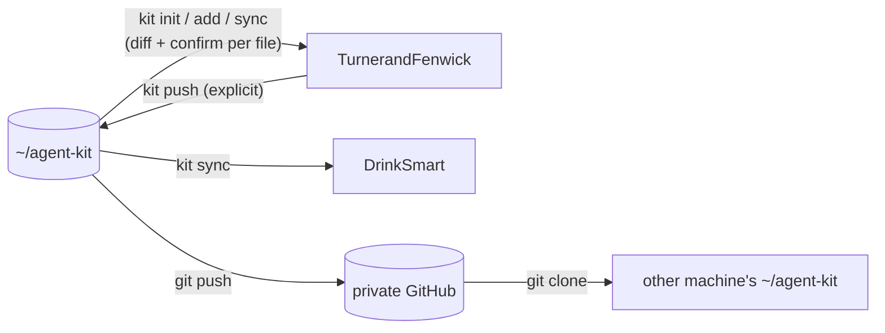

# Agent kit design

Settled in an interview with Oscar on 2026-10-03 and built the same day. The original was a Traycer artifact; this copy is the kit's own record. "As built" at the end records where the implementation made concrete choices the design left open.

## Goal

One project-agnostic source for the agent workflow layer that DrinkSmart has built up: skills, workflow docs, tools, hooks, permissions, record formats, MCP config and handoff/kickoff. Codex, Claude Code and opencode all share it. Starting a new repo, or moving between repos, should take one command and keep the same workflow.

DrinkSmart's current files are the canonical starting content. The kit is built from them, with DrinkSmart-specific facts taken out.

## Decisions

| Topic | Decision |
| --- | --- |
| Source of truth | A new git repo at `~/agent-kit`, pushed to a private GitHub repo so other machines can clone it. After extraction, the kit is canonical and DrinkSmart becomes a consumer. |
| CLI | `~/agent-kit/bin/kit` (Python, executable), symlinked as `~/.local/bin/kit`. `~/.local/bin` is already on `PATH`, so no `.bashrc` edit is needed. |
| Delivery into repos | Real copies committed in each repo, so a repo works for anyone who clones it. Collaborators (some on Windows) and Oscar's other machines don't need the kit. |
| `.claude/skills` vs `.agents/skills` | Two real copies, because Windows breaks git symlinks. `kit sync` keeps them identical and `kit status`/`kit doctor` flag any mismatch. |
| Other AI tools | The kit supports other AI coding tools as **targets**. Six tools need their own project skill folder; they're opt-in with `kit target add <tool>` (see "Tool targets"). |
| Direction | `sync`/`add` go kit → repo. `push` goes repo → kit. Both are explicit, and nothing moves automatically. |
| Incoming kit updates | Never applied silently. `sync` lists the new kit commits, shows each file's diff, and asks per file (`y` / `n` skip / `a` all remaining / `q` quit). |
| Local edits to kit files | `sync` never overwrites them. It reports them; you `kit push` them or `kit sync --discard`. |
| Project-only files | The kit tracks only files listed in the repo's receipt, so project skills, tools and workflows are invisible to it. A project file may not take a kit file's name. |
| New kit files from a repo | `kit push --new <path> --pack <pack>`. Without `--new`, `push` refuses files the kit doesn't know, so project files can't leak in by accident. |
| Project-specific workflow variations | Two ways: hook points in `docs/project_profile.md` for small additions, or a new project-owned workflow file for real differences, which can be `push --new`ed later if it turns out to be generic. There is no "detach". |
| Generic agent rules | A `<!-- kit:begin -->…<!-- kit:end -->` block inside each repo's `AGENTS.md`, managed by sync. Everything outside the block is project-owned. |
| Project facts | `docs/project_profile.md`: a TOML block of commands and file lists that scripts run, plus fixed prose headings for judgment, quirks and hook points. |
| History in workflows | Keep the reason for each rule in one line. Drop dates, wave names, DrinkSmart paths and incident counts. The full history stays in DrinkSmart's git log. |
| Lessons | Generic lessons are folded into the relevant kit workflow or skill. New repos start with an empty `tasks/lessons.md`. |
| Delegation spend ledger | Per project. `spend-guard` checks the repo's own `docs/delegation_spend.md`. |
| Harness independence | **Core contains nothing Traycer-specific.** A collaborator who clones a kit repo gets a complete, working setup without Traycer installed. Everything Traycer lives in the optional `traycer` pack (see "Traycer independence"). |
| Delegation without Traycer | Client-native subagents: the orchestrator spawns its own client's subagent with the `writespec` spec as the prompt, isolated in a git worktree, and accepts the result with `speccheck`. |
| Relay | An optional `relay` pack: `kit init --with relay`, or `kit add relay` at any time later. Requires the `traycer` pack. |
| Agent selection guide | Kit-owned, harness-neutral `docs/workflows/agent_selection.md` in core. The `traycer` pack additionally installs it to `~/.traycer/agent-selection-guide.md` on sync, with the same diff and confirm. Per-project model preferences go in the profile. |
| Global skills | **None.** Every skill Oscar uses is either a kit skill or a project skill. All user-level skills move into the kit and are deleted from home folders (see "No global skills" below). Vendor-managed skill folders are left alone. |
| Permissions | One kit list, translated and merged into Claude's `.claude/settings.json` and `opencode.json`, and generated as Codex's `.codex/rules/kit.rules`. Project entries are left alone. |
| Existing repos | `kit adopt` brings a repo that already has its own agent setup (DrinkSmart) under the kit. |
| Refero / Higgsfield | Not configured from Emad's setup. Built later from first principles as a project skill when the UI overhaul needs it, then `kit push --new`ed into the `ui-overhaul` pack. |
| `git commit` | Allowed for all agents. `git push` is denied for all agents. |
| Project deploy, migration and secret commands | Default is **deny**. Each project lists them in its own permission entries. |
| MCP servers | As packs. `kit add mcp-<name>` writes the server into `.mcp.json`, `opencode.json` and `.codex/config.toml` at once. Project-only servers are added by hand. |
| Machine checks | `kit doctor`, read-only. `--fix` applies the safe fixes after asking. |
| DrinkSmart migration | Build the kit from DrinkSmart and leave DrinkSmart untouched. Use the kit on TurnerandFenwick first, then convert DrinkSmart once the kit has proven itself. |

## Kit layout

```
agent-kit/
  bin/kit
  packs/
    core/
      pack.toml                 file list: kit path → repo path(s), managed blocks, merged entries
      skills/                   audit-context, bench, decision-check, find-skills, handoff, healthcheck,
                                kickoff, make-bench, skill-writing, speccheck, teacher, update-decisions,
                                writespec
      workflows/                agent_selection, benchmarking, change_safety, context_audit, delegation,
                                session_lifecycle, skill_authoring, verification, visual_check
      ORCHESTRATION.md
      agent_setup/              CROSS_MACHINE_SETUP, BOOTSTRAP_PROMPT, SKILL_CATALOG, CLAUDE_CODE_SETUP,
                                CODEX_SETUP (rewritten around the kit)
      tools/                    agent-lock, check-agent-setup, writespec-guard, spend-guard,
                                test-project (reads the profile), prepare-worktree (new, reads the profile)
      agents_block.md           the generic AGENTS.md rules block
      permissions.toml          generic permission entries
      hooks.toml                Claude PreToolUse wiring for writespec-guard and spend-guard
    traycer/                    optional; nothing in core refers to it
      workflows/delegation_traycer.md   spawning/messaging agents, Traycer worktrees, --expect-reply
      agents_block.md           extra AGENTS.md rules, active only when running under Traycer
      guard/traycer.py          writespec-guard matcher for `traycer agent send`
      home/agent-selection-guide.md   → ~/.traycer/agent-selection-guide.md
    relay/                      requires traycer
      skills/                   codex-tui-relay, relay-waker
      agent_setup/              CODEX_TUI_HUB_SETUP, CODEX_TUI_MESSAGE_RELAY, RELAY_WAKER
      tools/                    codex-tui-relay-ledger, relay-hub-waker, waker-daemon-start, traycer-identity
    mcp-playwright/   mcp.toml
    mcp-context7/     mcp.toml
    ui-overhaul/      later: skill + Refero/Higgsfield MCP, built from first principles in a project and pushed here
  templates/                    copied once by init, then owned by the project
    AGENTS.md                   project sections + empty kit block
    CLAUDE.md                   "@AGENTS.md" + a heading for Claude-specific notes
    docs/project_profile.md
    docs/decisions.md
    docs/delegation_spend.md
    tasks/next_session_kickoff.md, tasks/todo.md, tasks/lessons.md, tasks/kickoff_history/, tasks/specs/
    .claude/settings.json, opencode.json, .codex/config.toml, .mcp.json
    .gitignore additions        .worktrees/, CLAUDE.local.md, .claude/settings.local.json, *:Zone.Identifier
  CHANGELOG.md
```

Each skill is installed into both `.agents/skills/<name>/` and `.claude/skills/<name>/`. Codex-only `agents/openai.yaml` files are kept, since they are harmless to the other clients.

**Stays DrinkSmart-only:** `cloud_features_restart.md`, `release_build.md`, `launch_checklist.md`, `generate-app-icons.py`, `export-global-menu.mjs`, `KHANE_SETUP_GUIDE.md`, `PWA_SPEEDRUN.md`, the `CLAUDE.md` pitfalls and baseline sections (they move into DrinkSmart's profile at migration), and all specs and kickoff history.

## Four kinds of file in a kit repo

| Kind | Example | Init | Sync | Push |
| --- | --- | --- | --- | --- |
| Kit-owned file | `docs/workflows/delegation.md` | copied | updated with diff and confirm | allowed |
| Kit-managed region | the `AGENTS.md` kit block; kit entries in `settings.json`, `opencode.json`, `.mcp.json`, `.codex/config.toml` | inserted | only the region or entries are updated | allowed (block only) |
| Template | `docs/project_profile.md`, `docs/decisions.md` | copied once | never touched | refused |
| Project-only | `.agents/skills/medusa-migrations/` | — | invisible | only with `--new` |

## Commands

| Command | Does |
| --- | --- |
| `kit init [--with <pack>…]` | In a git repo (it runs `git init` first if there isn't one): installs core (plus any packs), copies the templates, writes the receipt. Refuses if a receipt already exists, or if the repo already has agent files (use `adopt`). |
| `kit adopt [--with <pack>…]` | For a repo with its own existing agent setup. See "Adopting an existing repo". |
| `kit add <pack>` / `kit remove <pack>` | Install or uninstall one pack later. `remove` asks before deleting files that were edited locally. |
| `kit target add <tool>` / `kit target remove <tool>` | Mirror all kit skills into one more tool's project skill folder, or take that copy out. |
| `kit status` | Read-only. For every tracked file and region: up to date, kit updated, edited here, or both changed. Also lists new kit commits since the last sync. |
| `kit sync [--discard]` | Applies kit updates file by file, showing the diff and asking before each. Never overwrites local edits unless `--discard` is given (still confirmed per file). With the `traycer` pack, also refreshes `~/.traycer/agent-selection-guide.md`. |
| `kit push <path>…` | Copies the repo version of tracked files or regions into `~/agent-kit`, shows the diff, commits there, and updates the receipt. |
| `kit push --new <path> --pack <pack>` | Adds a project file to the kit as a new kit-owned file. |
| `kit doctor [--fix]` | Checks this machine for this repo (see below). |

## Receipt and sync logic

`.agent-kit.lock` is committed in each repo. It records the kit commit last synced, the installed packs, and for every tracked file, region and merged entry a hash of exactly what was copied in.

| Kit vs receipt | Repo vs receipt | `sync` does |
| --- | --- | --- |
| same | same | nothing |
| changed | same | warns "kit updated", shows the diff, asks |
| same | changed | leaves it alone: "edited here — `kit push` it or `kit sync --discard`" |
| changed | changed | leaves it alone and shows both diffs |

The two skill copies are compared with each other too. If they differ, sync and status report it and you choose which copy wins.



## Project profile

`docs/project_profile.md` is project-owned. Kit workflows refer to its sections by name instead of hard-coding commands or paths.

```markdown
# Project profile — <name>

```toml
[commands]
install_fresh = "npm ci"            # new worktree; must not rewrite the lockfile
install_incr  = "npm install"       # after a lockfile-changing merge
typecheck     = "npm run typecheck"
lint          = "npm run lint"
test          = "npm test"
build         = "npm run build"
quick         = ["typecheck", "lint", "test"]
full          = ["typecheck", "lint", "test", "build"]
implementer   = ["typecheck"]       # what a delegated implementer runs itself

[worktree]
copy_files = [".env"]               # gitignored files a worktree needs, copied from the root checkout
root       = "/home/oscar/<Repo>"   # integration target
```

## Stack

## Known failures            (derive by running; never quote counts as truth)

## Blocked verification      (what can't be checked without real infrastructure)

## Delegation extras         (hook: extra steps delegation.md runs)

## Visual check extras       (hook: screens, viewports, how to launch the app)

## Model preferences         (overrides to the agent selection guide, if any)

## Quirks

```

`check-agent-setup` and `kit doctor` validate that the TOML block parses and its keys are known, and name the exact problem when they don't. Known failure counts are deliberately kept out of the TOML.

## Permissions

`packs/core/permissions.toml`:

```toml
[read]
deny  = [".env", ".env.*"]
allow = [".env.example"]

[bash]
deny = ["git push", "git push *", "git -C * push *"]
ask  = []
```

| Kit entry | Claude `.claude/settings.json` | opencode `opencode.json` |
| --- | --- | --- |
| read deny `.env.*` | `"Read(./.env.*)"` in `permissions.deny` | `"*.env.*": "deny"` in `permission.read` |
| bash deny `git push *` | `"Bash(git push *)"` in `permissions.deny` | `"git push *": "deny"` in `permission.bash` |

- Only entries listed in the receipt are added or removed. Project entries in the same files (e.g. DrinkSmart's `supabase db push *`) are never touched.
- Project deploy, remote-migration and secret commands default to **deny**. The templates carry an empty project deny list with commented examples.
- `git commit` is allowed everywhere. This removes the current opencode/Claude mismatch.
- Claude hook wiring (`hooks.toml`) is merged into `settings.json` the same way.
- Codex: the `.codex/config.toml` template sets `sandbox_mode = "workspace-write"` and `approval_policy = "on-request"`, and `permissions.toml` bash entries are generated into `.codex/rules/kit.rules` (see below).

### Codex rules (researched 2026-10-03, codex-cli 0.159.0)

Codex has an experimental rules feature: Starlark `.rules` files of `prefix_rule(...)` calls.

- **Location:** `rules/` next to any active config layer. User layer: `~/.codex/rules/default.rules`. Project layer: `<repo>/.codex/rules/*.rules`, loaded **only when the repo is trusted**, which `kit doctor` already checks.
- **Fields:** `pattern` (list of literal tokens; a nested list means "any of these"), `decision` (`allow` default, `prompt`, `forbidden`), `justification`, and `match`/`not_match` example lists that are validated when the file loads.
- **Several matches:** the most restrictive decision wins (`forbidden` > `prompt` > `allow`).
- **Shell wrappers:** `bash -lc "a && b"` is split into separate commands when the script is a plain chain (`&&`, `||`, `;`, `|`). If it has redirects, variables, substitutions or globs, the whole thing is judged as one command.
- **Testing:** `codex execpolicy check --rules <file> -- <command>` prints the decision as JSON.

Translation: kit `deny` becomes `decision = "forbidden"` with a justification, `ask` becomes `"prompt"`, and the kit's own examples become `match` entries, so a mistranslated rule fails loudly.

Verified locally against a test file:

| Command | Result |
| --- | --- |
| `git push origin main` | forbidden |
| `git commit -m x` | no match (allowed by the sandbox as normal) |
| `git -C /tmp push` | **no match** |

**Limitations to design around:**

1. **Patterns are literal prefixes with no wildcards.** Claude's `git -C * push *` can't be expressed, so `git -C <path> push` slips through. The generator therefore emits only the rules it can express exactly and lists the ones it can't in a comment. Agents are told never to use `git -C … push` in the `AGENTS.md` block. This matters because DrinkSmart's Codex sandbox has `network_access = true` (needed for Traycer), so a sandboxed push there is otherwise only stopped by missing credentials. The core `.codex/config.toml` template leaves network access off; the `traycer` pack turns it on.
2. The docs describe rules as governing commands **outside the sandbox**. Whether `forbidden` also blocks a command that would run inside the sandbox must be confirmed with a live test during the build (e.g. forbid a harmless command and ask Codex to run it).
3. When you approve a command in the Codex TUI, Codex **writes a rule to `~/.codex/rules/default.rules` itself**. That's a global file the kit doesn't own. `kit doctor` lists its contents so approvals don't quietly turn into permanent global permissions, but never edits it.
4. The feature is experimental and its format may change. `check-agent-setup` runs `codex execpolicy check` on the generated file's `match` examples, so a format change shows up as a failure.

- Personal machine settings in `~/.claude/settings.json` (the secrets-folder block hook, status line, auto mode) are outside the kit.

## MCP packs

Each pack has one `mcp.toml` describing the server. `kit add` writes it into all three client formats (`.mcp.json` `mcpServers`, `opencode.json` `mcp`, `.codex/config.toml` `[mcp_servers]`) as tracked entries. Wanted shared servers: **Playwright**, **Context7**, and the **UI overhaul tools** (Refero, Higgsfield) as part of a `ui-overhaul` pack. Project servers (Supabase, the Medusa docs MCP) are added by hand.

## `kit doctor`

Read-only checks, each printing its exact fix:

- `kit` on `PATH` and `~/agent-kit` is a clean git checkout, not behind its remote
- only with the `traycer` pack installed: `traycer` CLI on `PATH`; `~/.traycer/agent-selection-guide.md` matches the kit
- Codex trust entry `[projects."<repo>"]` present in `~/.codex/config.toml`
- receipt valid; every tracked file present
- `.agents/skills` and `.claude/skills` identical
- profile TOML parses and has the required keys
- no personal copies in `~/.agents/skills` or `~/.claude/skills` that shadow a kit skill
- `~/.config/opencode/opencode.jsonc` still points at those personal folders (fine, but flagged once they're emptied)

`--fix` applies only local, reversible fixes (trust entry, guide refresh, skill mirror), and asks first.

## No global skills

Every skill Oscar has made lives in the kit (core or a pack) or in one project. Nothing user-made stays in a home folder, so there is exactly one place to edit each skill.

Inventory on this machine (2026-10-03):

| Location | Contents | Action |
| --- | --- | --- |
| `~/.agents/skills/` | 8 own skills + `find-skills` (third-party, from vercel-labs/skills) | move into kit core, then delete |
| `~/.claude/skills/` | copies of the same 8 + a `find-skills` symlink | delete after reconciling |
| `~/.config/opencode/skills/`, `~/.factory/skills/`, `~/.kilo/skills/`, `~/.grok/skills/`, `~/.cursor/skills/`, `~/.kiro/skills/`, `~/.copilot/skills/`, `~/.kimi-code/skills/` | symlinks to `~/.agents/skills` | delete the symlinks |
| `~/.config/opencode/opencode.jsonc` | `skills.paths` pointing at the home folders | remove those paths |
| `~/.agents/.skill-lock.json` | `find-skills` install record | delete with the skill |
| `~/.claude/skills/synced/`, `~/.claude/skills/.trash/` | claude.ai-managed skills (docs, pdf, pptx, …) and their trash | **leave alone**, vendor-managed |
| `~/.codex/skills/.system/` | Codex built-ins | **leave alone**, vendor-managed |

Drift found: only `speccheck` differs (home copies vs DrinkSmart's repo copy). It's reconciled during extraction before any home copy is deleted. The other 7 are identical to DrinkSmart's copies.

Consequences, accepted:

- Outside a kit or project repo (e.g. `~` itself) no personal skills are available.
- The other tools' home skill folders were created by Traycer's skill fan-out on 2026-08-24, not by Oscar, and none of those tools is used today. Removing them loses nothing; in a kit repo those tools get skills through tool targets instead.
- `kit doctor` treats any user-made skill found in a home skill folder as a drift risk and names it, so new global skills don't creep back in. Skills installed with `npx skills add` or similar land in `~/.agents/skills` and will be flagged too; the fix is to move them into the kit.

## Traycer independence

DrinkSmart's setup assumes Traycer in a few places: `AGENTS.md` ("delegate through Traycer"), `agent_selection.md`, `writespec-guard` (it only recognises `traycer agent send`), `check-agent-setup`, the relay, and one or two lines each in `delegation.md`, `visual_check.md` and `change_safety.md`. The skills themselves (`writespec`, `speccheck`, `handoff`, `kickoff`, …) don't mention it. Extraction splits these:

| Concern | Core (everyone) | `traycer` pack (Oscar's machines) |
| --- | --- | --- |
| Delegation | `delegation.md` describes the harness-neutral loop: `writespec` → implementer in an isolated worktree → `speccheck` → integration branch → fast-forward. Default mechanism is the orchestrator client's **native subagents**. | `delegation_traycer.md`: spawning Traycer agents, Traycer-managed worktrees, `--expect-reply`, keeping agents warm. |
| Worktree isolation | Claude Code's subagents support worktree isolation directly. For clients whose subagents don't, the orchestrator runs `tools/prepare-worktree` and tells the subagent to work only there. | Traycer creates the worktrees. |
| Implementer choice | `agent_selection.md` names roles and models without naming a harness. | Installs the guide to `~/.traycer` and maps roles onto Traycer harnesses. |
| Spec enforcement | `writespec-guard` checks every subagent launch (Claude `Agent` tool) for the `writespec` scope and closing blocks. Enforced only in Claude Code; Codex and opencode follow the rule in the `AGENTS.md` block. | Adds the `traycer agent send` matcher. |
| `AGENTS.md` rules | No mention of any harness. | An extra block of Traycer rules, prefixed "When running under Traycer". |
| Relay | — | `relay` pack, which requires `traycer`. |

Because repos hold real committed copies, a collaborator who clones one of Oscar's repos **will** see the `traycer` pack's files. So every Traycer file and rule applies only when Traycer is actually present: the `traycer` CLI is on `PATH`, or the agent was launched by Traycer. Otherwise it states that the core native-subagent flow applies instead. This is the same pattern `codex-tui-relay` already uses (it stays inert outside a Traycer Codex TUI). `check-agent-setup` passes on a machine without Traycer.

This design spec is currently stored as a Traycer artifact. When the kit is built, it's copied to `~/agent-kit/docs/DESIGN.md` so the kit's own design isn't locked inside Traycer.

## Tool targets

Where each tool looks for **project** skills, taken from the skill-folder map in Traycer's host code (2026-10-03). Each tool's own docs should be checked when its target is first enabled.

| Tool | Project skill folders it reads | Covered by the default copies? |
| --- | --- | --- |
| Claude Code | `.claude/skills` | yes |
| Codex | `.agents/skills` | yes |
| opencode | `.opencode/skills`, `.claude/skills` | yes (plus `opencode.json` paths) |
| Kilo Code | `.kilo/skills`, `.claude/skills` | yes |
| GitHub Copilot | `.github/skills`, `.claude/skills` | yes |
| Amp | `.agents/skills` | yes |
| Cursor | `.cursor/skills` | no, needs `kit target add cursor` |
| Grok | `.grok/skills`, `skills` | no, needs `kit target add grok` |
| Kimi Code | `.kimi-code/skills`, `.kimi/skills` | no, needs `kit target add kimi` |
| Kiro | `.kiro/skills` | no, needs `kit target add kiro` |
| Droid (Factory) | `.factory/skills` | no, needs `kit target add droid` |
| Qwen Code | `.qwen/skills` | no, needs `kit target add qwen` |

- `kit init` writes the two default copies. `kit target add <tool>` adds one more mirrored copy of every kit skill (and lets `push --new` accept skills from that folder), recorded in the receipt. `kit target remove <tool>` takes it out.
- Targets are opt-in because each one commits another full copy of all ~13 skills into the repo. Enabling all six unused ones would mean about 80 extra skill folders per repo for tools nobody runs yet. Turning one on later is a single command and `sync` keeps it identical from then on.
- `kit status` and `kit doctor` check that every enabled target's copy matches.

## Adopting an existing repo

`kit adopt` is for a repo that already has skills, workflows and settings of its own, like DrinkSmart. It never overwrites anything without asking.

1. **Match:** for every kit file, finds the repo's counterpart at the same path, or by skill name.
2. **Compare and choose, per file:**
| Situation | Choice offered |
| --- | --- |
| identical to the kit | tracked as up to date, no prompt |
| differs | shows the diff, then: take the kit version / keep the repo version as a local edit (`kit push` it later) / `push` the repo version into the kit now |
| kit file has no counterpart | install it, or skip |
| repo file has no kit counterpart | left as project-only, untracked |
3. **Managed regions:** shows a proposed `AGENTS.md` kit block and the permission/hook entries the kit would own, next to what the repo has now, and asks before inserting them. Existing lines that duplicate a kit entry become kit-tracked instead of being added twice.
4. **Profile:** creates `docs/project_profile.md` if it's missing, pre-filled with any commands it can find (`package.json` scripts, `tools/test-project`), and lists project facts it found in kit workflows that should move there.
5. **Receipt:** writes `.agent-kit.lock` and prints a summary. Nothing is committed; you review `git diff` and commit yourself.

`kit adopt --dry-run` prints the whole plan without touching anything.

## Generalisation rules for extraction

When moving a DrinkSmart file into the kit:

1. Replace commands and paths with profile references: "run `install_fresh` from the profile", not `npm ci`; "copy `worktree.copy_files`", not `cp /home/oscar/DrinkSmart/.env`.
2. Keep each rule's reason in one line. Drop dates, wave names, incident counts and DrinkSmart file names.
3. Rules that only make sense for DrinkSmart's stack (Supabase, Capacitor, the BAC engine) move to DrinkSmart's profile or `CLAUDE.md`, not the kit.
4. Where DrinkSmart has project content in the middle of a workflow (e.g. `visual_check.md` screens), turn it into a profile hook point.
5. Generic lessons from `CLAUDE.md` pitfalls and `docs/decisions.md` (e.g. "a fresh worktree has no dependencies installed", "a type check that compiles zero files proves nothing") are folded into the relevant workflow.
6. Reconcile the drifted copies of each skill (repo `.agents` vs `.claude` vs `~/.agents` vs `~/.claude`) first. The DrinkSmart repo copy wins unless the diff shows the personal copy is newer and better. Any disagreement is shown to Oscar.

## Rollout

1. Create `~/agent-kit`, extract core, `traycer` and `relay` from DrinkSmart following the rules above (Traycer content goes only into the `traycer` pack), write `bin/kit`, symlink it into `~/.local/bin`, and copy this spec to `docs/DESIGN.md`. DrinkSmart is not modified. Acceptance includes a core-only `kit init` in a scratch repo passing `check-agent-setup` with Traycer hidden from `PATH`.
2. In TurnerandFenwick: first commit, `kit init`, fill in `AGENTS.md` and the profile for Medusa + Next.js, move `PROJECT_PLAN.md` and `UI_OVERHAUL_SKILL.md` into `docs/` to match the README.
3. Work in TurnerandFenwick for a while, improving the kit via `kit push`.
4. Remove all global skills (see "No global skills"), once the kit holds every one of them and TurnerandFenwick works with it.
5. Convert DrinkSmart with `kit adopt`, and move the DrinkSmart facts into its profile.
6. Push `~/agent-kit` to private GitHub.

## Open questions

- Does Codex's `forbidden` rule also block commands that would run inside the sandbox? To be confirmed with a live test during the build.
- How Codex's and opencode's native subagents handle worktree isolation, and whether either can enforce the writespec rule with a hook as Claude can. To check during the build.

## As built (2026-10-03)

- **Pack layout is by convention, not a manifest.** A pack directory may contain `skills/<name>/`
  (each installed into every skill target), `files/` (mirrored to the same path in the repository),
  `agents_block.md`, `gitignore_block`, `codex_block.toml` (a marked block in `.codex/config.toml`),
  `permissions.toml`, `hooks.toml`, `mcp.toml`, and `pack.toml` (`description`, `requires`, and
  `[[home]]` machine-file installs).
- **Units.** `kit` tracks four kinds of entry: whole files; marked regions (`<!-- kit:begin NAME -->`
  in markdown, `# kit:begin NAME` in `.gitignore`/TOML); single JSON entries (a list item or a key)
  in `.claude/settings.json`, `opencode.json`, `.mcp.json`; and generated files
  (`.codex/rules/kit.rules`). All four go through the same kit/receipt/repo comparison.
- **Receipt** `.agent-kit.lock` is JSON: `kit_commit`, `packs`, `targets`, and per entry its kind,
  pack, path and a 16-hex-digit SHA-256 prefix of what the kit wrote.
- **`ORCHESTRATION.md` stays at the repository root**, as in DrinkSmart.
- **Profile keys:** `[commands]` (name → shell command, including `install_fresh`/`install_incr`),
  `[profiles]` (name → command names), `[implementer]` (`run`, `skip`, `forbid`, `blocked`),
  `[worktree]` (`copy_files`, `dependency_files`). `tools/agent_profile.py` parses and validates it.
- **Spec blocks.** `scope.md` and `closing.md` stay fixed text; `baseline.md` became
  `baseline.md.tmpl`, rendered by `tools/spec-block baseline` from `[implementer]`. The guard renders
  the same text to compare.
- **writespec-guard** governs Claude Code `Agent`/`Task` calls with `isolation: "worktree"` in core.
  Other harnesses plug in as `tools/writespec_guard_*.py` modules (`extract(payload)`); the traycer
  pack ships one for `traycer agent send`. A dispatch may name its spec file under `tasks/specs/`
  instead of inlining it.
- **check-agent-setup plugins:** packs add `tools/check_agent_setup_*.py` modules (`check(root, fail)`).
- **Read-deny translation:** each name becomes `Read(./NAME)` and `Read(**/NAME)` for Claude and
  `*NAME` for opencode. Codex has no read rules; its sandbox applies.
- **A TOML block that would make `.codex/config.toml` invalid is not written** (for example when the
  project already defines the same table); `kit` says so and leaves the entry untracked.
- **`kit adopt`** lists identical, new and differing entries first (`--dry-run` stops there), offers
  missing starter files, then asks per differing file: take kit / keep repo / push repo version to
  the kit. It also flags pre-existing hook entries that duplicate the kit's.
- **Skill copies include `agents/openai.yaml` in every target**, so all copies are byte-identical.
- Verified on 2026-10-03: core-only `kit init` passes `check-agent-setup` with Traycer hidden from
  `PATH` (including `codex execpolicy` loading the generated rules); status/sync/push/push --new,
  conflicts, `--discard`, kit-side removal, `add`/`remove` of packs, tool targets, `prepare-worktree`
  and a full `adopt` of a DrinkSmart clone were exercised in scratch repositories.
